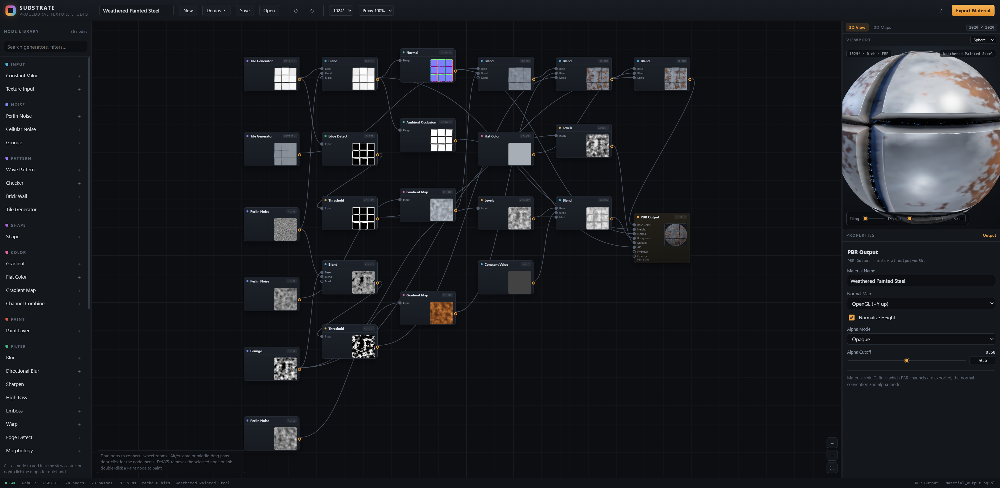
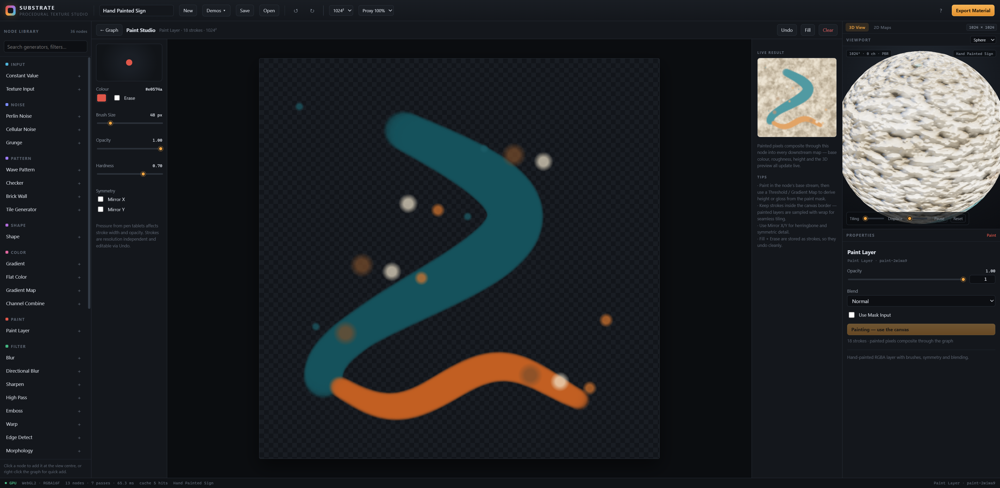
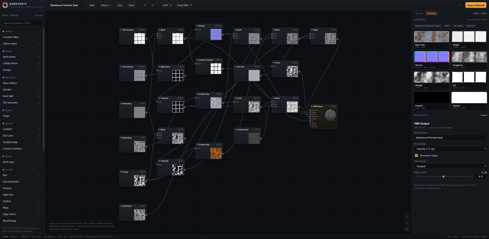
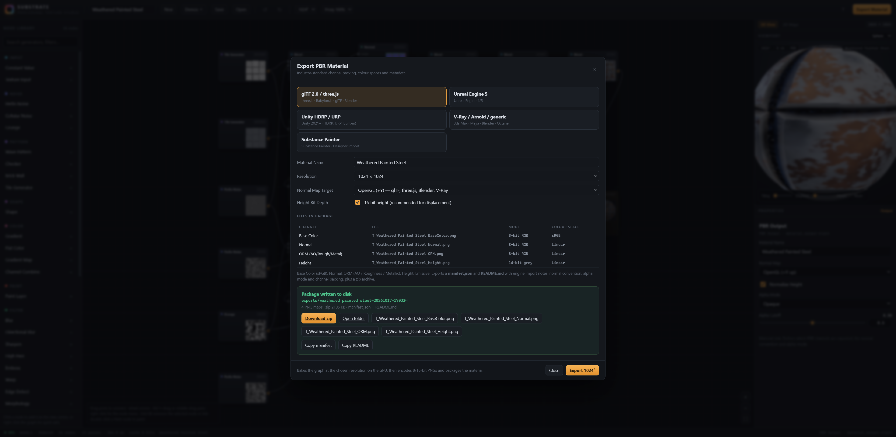

# Substrate — Procedural Texture Studio

A **Substance Designer–style** material authoring tool: build node graphs that generate PBR textures on the GPU,
paint on them by hand, preview the result as a lit 3D material, and export an industry-standard texture package.

**Vue 3 + Three.js + Node.js** · zero-bundler native ES modules · WebGL2 (RGBA16F) · no build step required to run.



---

## Highlights

- **Node graph editor** — pan/zoom canvas, drag-to-connect, marquee select, undo/redo, node thumbnails rendered
  from the actual GPU result, right-click node creation with search.
- **36 GPU nodes** — tileable fBm Perlin, Worley/cellular, grunge, patterns, SDF shapes, gradients, blurs, warps,
  normal/AO/curvature generators, blend modes, channel packing helpers.
- **Hand painting** — a real Paint Studio with pressure-sensitive brushes, hardness/opacity/size, eraser, fill,
  X/Y symmetry, stroke-level undo. Paint is rasterised to a canvas texture and composited through the node graph,
  so painted strokes can drive base colour, roughness, height, masks — anything.
- **Live PBR preview** — Three.js `MeshStandardMaterial` with procedural IBL, ACES tone mapping, five preview
  meshes, tiling, displacement and auto-spin.
- **2D channel inspection** — all eight PBR channels with colour-space labels, one-click full-size zoom.
- **Industry-standard export** — five presets (glTF/three.js, Unreal, Unity HDRP, V-Ray/Arnold/generic,
  Substance Painter), correct sRGB vs linear handling, ORM / Mask Map packing, OpenGL↔DirectX normal flipping,
  16-bit height, adaptive-filter PNG encoder, `manifest.json` + `README.md` + zip package written by the Node server.
- **Verified pipeline** — a built-in self-test audits every GLSL program, evaluates the graph, validates normals
  and seamless tiling, and exports a package; an independent Node verifier decodes the PNGs, validates CRCs,
  chunk colour spaces, bit depths, zip integrity and tile seams.



---

## Quick start

Requirements: **Node.js 18+** and a **WebGL2** browser (Chrome/Edge/Firefox/Safari 16+).

```bash
npm install          # installs vue + three (the app itself needs no bundler)
npm start            # http://127.0.0.1:3000
```

Alternative scripts:

```bash
npm run build        # copies app + vendor ESM into dist/
npm run serve:dist   # serve the built dist/ on port 3000
PORT=3001 npm start  # custom port
```

The first launch loads a built-in demo material. Edit, paint, export — everything is persisted to the browser
(local autosave) and can be saved as named projects on the Node server.

---

## Using the app

### Graph editing

- **Add nodes** — click an entry in the Node Library, or right-click the canvas for the searchable quick-add menu.
- **Connect** — drag from a node's right-hand port onto an input dot. Connections are type-less RGBA streams;
  every node returns a linear-light RGBA texture.
- **Select / move** — click, shift-click, or marquee-drag on empty canvas. Drag nodes to rearrange.
- **Delete** — `Del` removes selected nodes or a selected link. Right-click a node for duplicate/disconnect/delete.
- **Undo / redo** — `Ctrl/Cmd+Z`, `Ctrl/Cmd+Shift+Z` (also in the toolbar).

### Editing parameters

Select a node; the Properties panel shows schema-driven widgets: sliders + numeric fields, toggles, select menus,
colour pickers, 2D vectors, and a multi-stop gradient editor (click the ramp to add stops, drag/select to edit).

### Painting

Double-click a **Paint Layer** node (or select it and press *Open Paint Studio*).

- Brush colour, size, opacity, hardness, eraser, and X/Y mirror symmetry.
- Pen pressure (Pointer Events `pressure`) modulates brush size and opacity.
- Strokes are stored as data, rasterised at 1024², uploaded as a texture, and composited into the node stream;
  downstream maps and the 3D preview update live.
- Keep strokes inside the canvas border — the paint texture is sampled with wrap for seamless tiling.
- Undo removes whole strokes. Fill and Clear are also stored as undoable operations.

### 2D channel maps

Switch the right panel to **2D Maps** to inspect the eight PBR channels with their colour space and packing
metadata, and click any map for a full-size view.



### Export

Press **Export Material**, choose a preset, resolution (512 → 4096) and normal-map convention.



The server writes the package under `exports/<material>-<timestamp>/` and returns a zip. The dialog offers
per-file downloads, the zip, and copyable manifest/README text.

---

## Architecture

```
┌──────────────────────────── browser (native ESM, no bundler) ───────────────────────────┐
│  Vue 3 UI (runtime template compiler)                                                    │
│   App · GraphEditor · Inspector · NodePalette · Preview3D · MapPanel · PaintStudio ·      │
│   ExportDialog                                                                            │
│                                                                                           │
│  engine/store.js      reactive graph model, undo history, paint sync, autosave            │
│  engine/engine.js     WebGL2 render-target graph evaluator (Three.js RawShaderMaterial)   │
│  engine/compiler.js   node definition → GLSL ES 3.00 fragment shader                      │
│  engine/nodes/*.js    declarative node library: inputs, param schema, GLSL bodies          │
│  engine/png.js        PNG encoder: 8/16-bit, grey/RGB/RGBA, adaptive row filters, sRGB     │
│  engine/exporter.js   channel packing, PNG planning, manifest/README generation            │
│  engine/selftest.js   shader audit + graph/normal/seam validation + export test            │
│  engine/webmcp.js     WebMCP tool surface for agent-driven verification                    │
└───────────────────────────────────────────┬───────────────────────────────────────────────┘
                                            │ /api (JSON, base64 PNG payloads)
┌───────────────────────────────────────────▼───────────────────────────────────────────────┐
│  Node.js server (node:http, zero dependencies)                                            │
│   static app + /vendor ESM mapping · project save/load · export writer · zip (store/deflate)│
│   debug report sink for automated self-tests                                               │
└───────────────────────────────────────────────────────────────────────────────────────────┘
```

### Why zero-bundler ESM?

The application is served as plain ES modules with an **import map** that resolves `vue` and `three` to the
installed ESM builds (`/vendor/...`). `npm install` is only needed to obtain those two libraries — there is no
transpilation, bundling or dev-server layer. Components are plain `.js` modules with Vue template strings;
`npm run build` simply copies the app and the two vendor entry points into `dist/` for deployment.

This keeps the runtime identical in development and production, removes build-tool failure modes, and makes the
whole application inspectable in the browser network panel.

### GPU graph evaluation

- Every node renders a full-screen quad into an **RGBA16F** render target (`THREE.WebGLRenderTarget`), linear light.
- Node definitions are declarative: inputs, parameter schema and a GLSL body implementing `vec4 nodeColor(vec2 uv)`.
  The compiler emits the full GLSL ES 3.00 fragment shader (uniform declarations, gradient sampler functions,
  shared noise/colour helpers, output clamp).
- Multi-pass nodes (`Blur`, `Morphology`) read the previous pass through `uPrev`; separable filters run two passes.
- The graph is topologically sorted from the PBR Output sink; each node gets a **structural hash** of its type,
  parameters, input hashes, resolution and paint/image versions. Unchanged branches are served from an LRU cache,
  so dragging a slider only recomputes downstream nodes.
- Tileable generators use periodic hashing (`mod(cell, period)`) so every noise/pattern node wraps exactly.
- Evaluation runs at document resolution × proxy scale; export re-bakes at the target resolution in a streaming mode
  that releases intermediate targets as their last consumer completes.

### Colour management

- All processing is **linear light** on `RGBA16F` targets.
- Colour parameters are authored in sRGB and converted to linear on upload (including gradient stops).
- Base Colour and Emissive are sRGB-encoded on readback/export; normal, roughness, metallic, AO and height stay linear.
- The 3D preview marks base colour/emissive textures as `SRGBColorSpace`, everything else as linear data.

### Export pipeline

1. Evaluate the graph at export resolution (streaming mode, ref-counted target releases).
2. Read each channel through an encode pass into RGBA8 (8-bit) or RGBA32F → unorm16 (16-bit) readback.
3. Pack channels per preset: base colour (+alpha), normal (with OpenGL↔DirectX green flip), ORM, Unity Mask Map,
   or separate roughness/metallic/AO/height maps.
4. Encode PNG in-page: 16-bit greyscale for height, 8-bit RGB/RGBA/grey for the rest, **adaptive per-row filters**
   (None/Sub/Up/Average/Paeth) for small files, `sRGB` chunk on colour maps, `Software` tEXt metadata.
5. POST the files plus manifest/README to the server, which writes the folder and builds a zip
   (PNG entries stored, text entries deflated; CRC-32 everywhere).

---

## Node library

| Category | Nodes |
| --- | --- |
| **Input** | Texture Input (bitmap loader), Constant Value (raw data), Flat Color |
| **Noise** | Perlin Noise (tileable fBm), Cellular Noise (F1/F2/borders), Grunge |
| **Pattern** | Wave Pattern, Checker, Brick Wall, Tile Generator (coloured tiles or bevel height) |
| **Shape** | Shape (rounded box / ellipse / polygon / star SDF) |
| **Color** | Gradient (multi-stop, 4 modes), Gradient Map, Channel Combine |
| **Paint** | Paint Layer (brush, symmetry, blend modes, mask input) |
| **Filter** | Blur, Directional Blur, Sharpen, High Pass, Emboss, Warp, Edge Detect, Morphology (dilate/erode), Transform 2D |
| **Blend** | Blend (15 modes, opacity, mask) |
| **Adjust** | Levels, Histogram Scan, Invert, HSL, Desaturate, Threshold, Posterize |
| **Normal** | Normal (height → tangent-space normal, OpenGL/DirectX), Ambient Occlusion, Curvature |
| **Output** | PBR Output (8 channels, material name, normal convention, alpha mode) |

All generators are resolution-independent and seamless. Filters that sample across the texture edge inherit the
wrap, so the pipeline preserves tiling end-to-end (verify with the self-test seam ratios ≈ 1.0).

---

## Industry standards implemented

| Concern | Implementation |
| --- | --- |
| **Colour space** | Linear-light processing; sRGB encode for base colour/emissive only; data maps remain linear (`sRGB` PNG chunk present/absent accordingly). |
| **Metallic/Roughness workflow** | Metallic and roughness exported separately and packed for glTF/Unreal (`ORM`: R=AO, G=Roughness, B=Metallic). |
| **Unity HDRP Mask Map** | R=Metallic, G=AO, B=Detail(0.5), A=Smoothness (1−Roughness). |
| **Normal maps** | Tangent-space, 8-bit RGB, normalised in shader; OpenGL (+Y) or DirectX (−Y) selectable, source→target conversion when exporting. |
| **Height / displacement** | 16-bit greyscale PNG with optional min/max normalisation for displacement and parallax. |
| **Alpha** | `Opaque / Masked / Blended` — base colour exports RGBA with the Opacity channel when enabled. |
| **Tiling** | All generators periodic; PNG seam ratios verified programmatically. |
| **Packaging metadata** | `manifest.json` (resolution, colour spaces, normal convention, alpha mode, ORM packing, per-file bit depth) and a `README.md` with import instructions for three.js, Unreal and Unity. |
| **PNG correctness** | Valid IHDR/IDAT/IEND, CRC-32 per chunk, zlib stream via `CompressionStream` with a stored-deflate fallback, adaptive filtering, 8/16-bit grey/RGB/RGBA. |
| **Zip integrity** | Local + central directory headers, CRC-32, store/deflate methods, verified by an independent parser. |

---

## Project persistence & server API

Projects are JSON graphs (`projects/<slug>.json`), created with **Save** / **Open** in the toolbar. The current
session is also autosaved to `localStorage` so a refresh restores your work.

| Method & path | Purpose |
| --- | --- |
| `GET /api/health` | Server mode, versions, project/export counts. |
| `GET /api/projects` | List saved projects (name, resolution, node count, timestamp). |
| `POST /api/projects/save` | Save a project JSON (`{name, graph, resolution}`). |
| `GET /api/projects/load?name=` | Load a project by name. |
| `POST /api/export` | Write a material package and zip (`{materialName, files:[{path,data:base64}], manifest, readme}`). |
| `GET /api/exports` | Recent export packages. |
| `POST /api/debug/report` · `GET /api/debug/last?kind=` | Sink for automated self-test reports. |
| `GET /exports/...` | Exported packages (zip served with `Content-Disposition`). |

---

## Keyboard shortcuts

| Keys | Action |
| --- | --- |
| `Ctrl/Cmd + Z` / `Ctrl/Cmd + Shift + Z` | Undo / redo |
| `Ctrl/Cmd + D` | Duplicate selected nodes |
| `Del` / `Backspace` | Delete selected node(s) or link |
| `Ctrl/Cmd + S` | Save project |
| `Ctrl/Cmd + E` | Open export dialog |
| `Esc` | Leave Paint Studio / close dialogs |
| Wheel | Zoom graph · Alt/middle-drag pans |

---

## Verification & testing

The project ships with three independent verification layers.

### 1. In-app self-test (GPU pipeline)

Open `http://127.0.0.1:3000/?selftest=1&export=1` (optionally `&demo=mossy-rock&res=512`). The page:

- compiles **every node's GLSL** directly against the WebGL context (report at `window.__SELFTEST__.shaders`),
- evaluates the graph, checks GL errors and thumbnail generation,
- reads back every channel and validates colour variance, normal unit length and outward orientation,
- measures wrapped-edge discontinuities against the **local gradient** for seamless tiling,
- optionally bakes and exports a full package.

Results are printed on screen and POSTed to `/api/debug/last?kind=selftest`.

You can also run the same test through the page's **WebMCP** tools (registered on `document.modelContext`):

| Tool | Purpose |
| --- | --- |
| `substrate_state` | Material, node/link counts, wiring, evaluation stats, undo state. |
| `substrate_selftest` | Shader audit + evaluation + channel/normal/seam validation. |
| `substrate_export` | Bake + export a package; returns files, sizes, PNG signatures, server paths. |
| `substrate_load_demo` | Switch between the built-in demos. |
| `substrate_paint` | Add brush strokes programmatically and re-evaluate (painting pipeline test). |

### 2. Independent package verifier (Node)

```bash
npm run verify                       # newest package in exports/
node scripts/verify-export.mjs exports/<package>
```

It re-implements PNG decoding with `node:zlib` (chunk CRCs, inflate, scanline unfiltering), checks:
resolution, bit depth and colour type per channel, sRGB chunk presence rules, `Software` tEXt metadata,
wrapped-edge seam ratios, manifest structure, README sections, and every zip entry against the files on disk.

Latest run: **4/4 demo packages passed** (all PNGs CRC-valid, correct colour spaces, seam ratios ≈ 1.0,
6 clean zip entries each).

### 3. Browser automation helper

`scripts/cdp.mjs` connects to Chrome's DevTools Protocol via Node's native WebSocket — useful for
evaluating expressions in the running app, capturing screenshots to files and collecting console logs:

```bash
node scripts/cdp.mjs list
node scripts/cdp.mjs eval "window.__SUBSTRATE__.state.lastEvalMs"
node scripts/cdp.mjs shot docs/screenshots/01-graph-3d.png
node scripts/cdp.mjs logs 3000
```

---

## Performance notes

Measured in Chrome on an NVIDIA laptop GPU (ANGLE/D3D11 backend) with WebGL2 and RGBA16F targets:

| Scenario | Result |
| --- | --- |
| 24-node weathered-steel graph @1024² (23 passes) | ~120–200 ms full evaluation, ~5–30 ms with cache warm |
| Slider drag (proxy 100%) | only downstream nodes re-render (structural hash cache) |
| Painting @1024² | ~20–30 ms per update (throttled to ~10 Hz while the brush moves) |
| 2K export (4 maps + zip) | ~5.5 s including PNG encoding and packaging |
| Shader audit (37 fragment programs) | < 150 ms |

Document resolution is capped at 4096²; export at 4K requires roughly 1–2 GB of GPU memory for the streaming bake.

---

## Project layout

```
index.html                 import map + boot
package.json               dependencies (vue, three) and scripts
server/index.js            zero-dependency Node server (static, API, zip writer)
scripts/build.mjs          copies app + vendor ESM into dist/
scripts/verify-export.mjs  independent material-package verifier
scripts/cdp.mjs            Chrome DevTools Protocol helper (eval/screenshot/logs)
src/main.js                boot: mount app, create engine, restore session, self-test hook
src/App.js                 layout, toolbar, dialogs, shortcuts, preview scheduling
src/styles.css             dark studio theme
src/components/            GraphEditor, Inspector, NodePalette, Preview3D, MapPanel,
                           PaintStudio, ExportDialog, GradientEditor
src/engine/engine.js       WebGL2 graph evaluator, caches, readback, thumbnails
src/engine/compiler.js     node def → GLSL
src/engine/glsl.js         shared GLSL helpers (tileable noise, colour, preview shading)
src/engine/nodes/          generators, filters, output node definitions
src/engine/store.js        reactive model, history, painting sync, evaluation scheduling
src/engine/demos.js        three authored demo graphs + paint strokes
src/engine/png.js          PNG encoder (adaptive filters, 8/16-bit)
src/engine/exporter.js     presets, channel packing, manifest/README
src/engine/selftest.js     automated pipeline validation
src/engine/webmcp.js       WebMCP tool registration
exports/                   generated material packages (git-ignored; produced by Export)
docs/screenshots/          documentation images
```

---

## Limitations & possible next steps

- **WebGL2 + float render targets required.** Without `EXT_color_buffer_float` the engine falls back to 8-bit
  targets (visible warning in the status bar) and 16-bit height export is up-sampled from 8-bit.
- **No node-group/function nodes yet** — large graphs stay flat. A subgraph node type is the natural next addition.
- **Painting is 2D stroke-based**, not a full layer stack; the Paint Layer node can be chained for more layers.
- **Image input is loaded into the graph** but not stored in the project as a file path (it is embedded as a data URL
  in the saved JSON, which keeps projects self-contained at the cost of size).
- **Custom shader nodes** (user GLSL) would be straightforward: the compiler only needs a `nodeColor` body and a
  parameter schema.
- Exports are colour-space-correct but not yet validated against an engine importer; the manifest is designed so a
  small importer script (Unity/Unreal/three) could consume it directly.

---

## License

MIT — use it, modify it, ship it.
