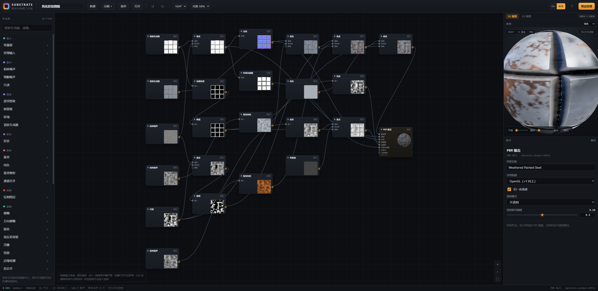
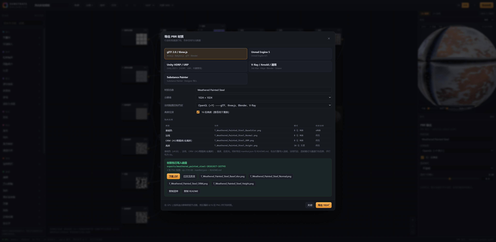
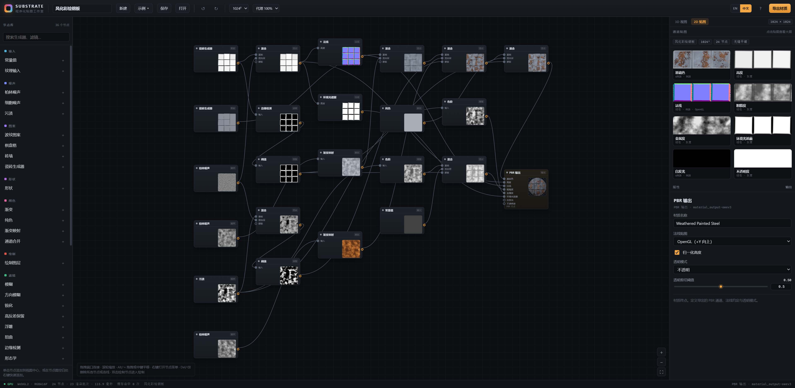
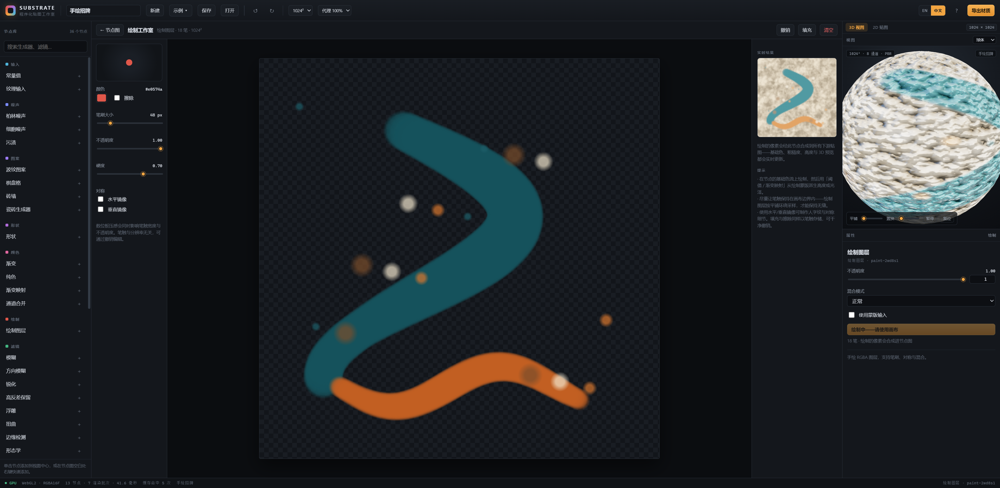
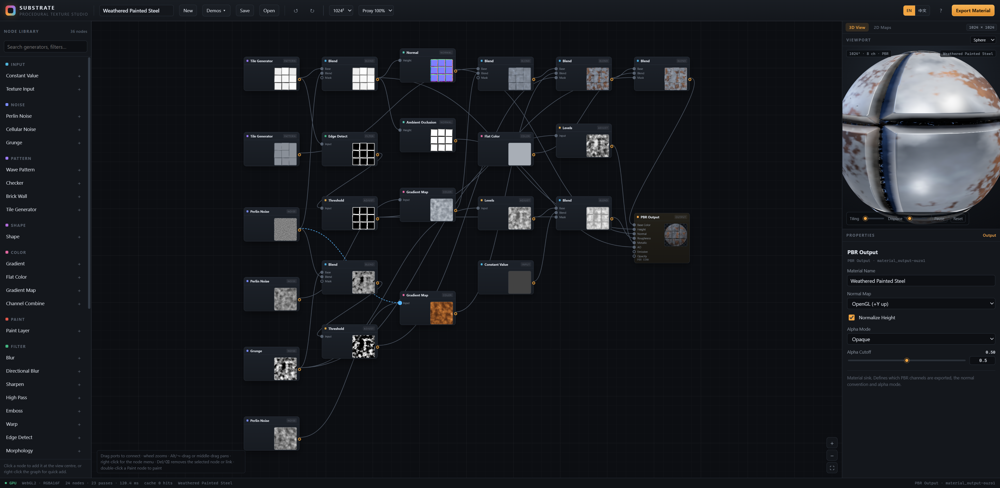
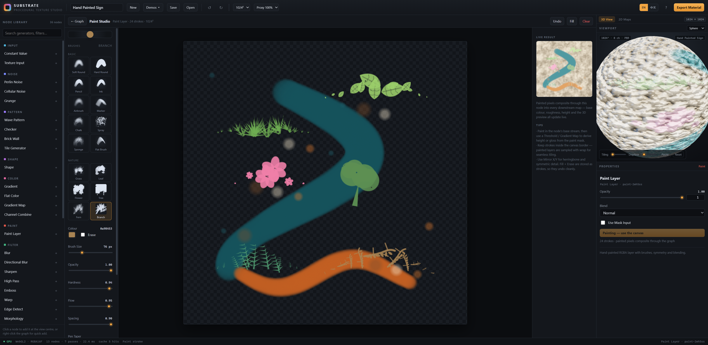
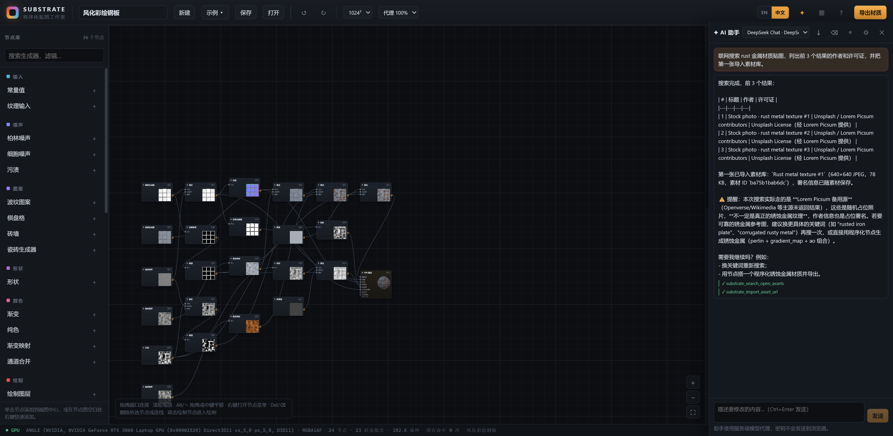
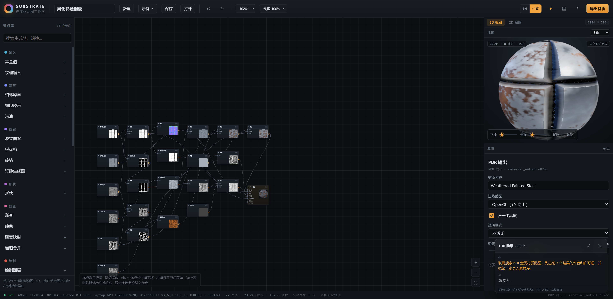
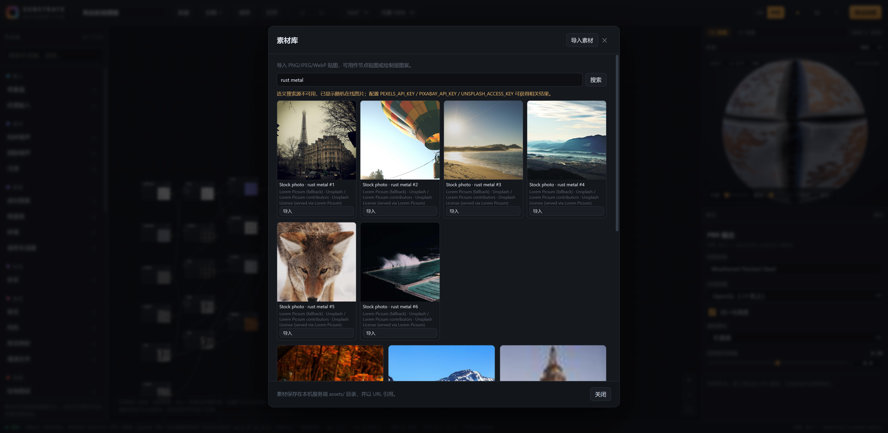

# Substrate — Procedural Texture Studio

**English** · [简体中文](README.zh-CN.md) · [Chinese docs index](docs/zh/README.md)

A **Substance Designer–style** material authoring tool: build node graphs that generate PBR textures on the GPU,
paint on them by hand, preview the result as a lit 3D material, and export an industry-standard texture package.

**Vue 3 + Three.js + Node.js** · zero-bundler native ES modules · WebGL2 (RGBA16F) · no build step required to run.


---

## Highlights

- **Node graph editor** — pan/zoom canvas, drag-to-connect with a live **curved link preview that snaps to input
  ports**, marquee select, undo/redo, node thumbnails rendered from the actual GPU result, right-click node creation
  with search.
- **36 GPU nodes** — tileable fBm Perlin, Worley/cellular, grunge, patterns, SDF shapes, gradients, blurs, warps,
  normal/AO/curvature generators, blend modes, channel packing helpers.
- **Hand painting** — a real Paint Studio with **16 built-in brushes** in two groups: *Basic* (soft/hard round,
  pencil, ink, airbrush, marker, chalk, spray, sponge, flat) and *Nature* (**grass, leaf, flower, tree, fern,
  branch** — procedurally drawn foliage motifs with rotation/scale jitter) driven by grain, scatter, flow and
  spacing, plus pressure-sensitive size/flow,
  hardness/opacity, eraser, fill, X/Y symmetry and stroke-level undo. Strokes are smoothed with **cubic Bézier
  curves** (Catmull-Rom through the sampled pointer path) and an optional **pen taper (笔锋)** thins the start and
  end of each stroke. The chosen brush and its settings are remembered between sessions. Paint is rasterised to a
  canvas texture and composited through the node graph, so painted strokes can drive base colour, roughness, height,
  masks — anything.
- **Live PBR preview** — Three.js `MeshStandardMaterial` with procedural IBL, ACES tone mapping, five preview
  meshes, tiling, displacement and auto-spin.
- **2D channel inspection** — all eight PBR channels with colour-space labels, one-click full-size zoom.
- **Industry-standard export** — five presets (glTF/three.js, Unreal, Unity HDRP, V-Ray/Arnold/generic,
  Substance Painter), correct sRGB vs linear handling, ORM / Mask Map packing, OpenGL↔DirectX normal flipping,
  16-bit height, adaptive-filter PNG encoder, `manifest.json` + `README.md` + zip package written by the Node server.
- **MCP / agent integration** — a normalized external MCP gateway that **starts with the app** (stdio + HTTP
  JSON-RPC, 31 tools) plus a built-in **MCP self-check**; in-page WebMCP tools are also available.
- **AI assistant** — a top-bar **✦** panel connected to DeepSeek (default) or any OpenAI-compatible provider.
  The assistant runs **server-side** and drives the app through the MCP tools (edit graphs, paint, evaluate,
  export). API keys never reach the browser; models/providers can be switched and added from the panel.
  Chat attachments: images (PNG/JPEG/WebP) are added to the material library and can be applied through
  `substrate_list_assets`/`substrate_apply_asset`; text files are included in the message.
  Tools carry copy-pasteable examples and return actionable hints (`details.example`/`details.availableNodes`)
  when arguments are wrong.
- **Persistent AI conversation** — full history and tool traces are saved and restored after reloads, can be
  exported as Markdown; closing the dialog **does not cancel a reply**, and an in-flight conversation appears in
  a translucent floating window (auto-scroll, expandable). Enforced AI rules forbid touching source code,
  API keys/environment, files or system information.
- **Material library** — import PNG/JPEG/WebP textures, search open-license material **online**, preview/delete
  them, use them as graph textures or as paint-layer pattern fills in the Paint Studio (with creator/license
  attribution for online results).
- **Custom brushes** — import brush definitions from JSON (full preset parameter set), stored locally and shown
  in a Custom group; see [docs/brushes.md](docs/brushes.md).
- **Verified pipeline** — a built-in self-test audits every GLSL program, evaluates the graph, validates normals
  and seamless tiling, and exports a package; an independent Node verifier decodes the PNGs, validates CRCs,
  chunk colour spaces, bit depths, zip integrity and tile seams.


---

## Bilingual UI / 双语界面

The whole interface is available in **English** and **简体中文** — switch with the `EN / 中文` control in the
top bar, or with `?lang=zh` / `?lang=en` in the URL. The choice is remembered in the browser; on first launch the
UI follows the browser language.

Node names, node descriptions, parameter labels, select-menu options, tooltips, status bar, history actions,
dialogs, error messages and the help text are all translated. Your data (project name, material name, custom node
titles) is never rewritten — material names are additionally kept ASCII-friendly for export file names.

| 中文界面 · 节点图 | 中文界面 · 导出对话框 |
| --- | --- |
|  |  |





---

## Documentation

- **English**: this README · [`docs/mcp.md`](docs/mcp.md) · [`docs/llm.md`](docs/llm.md) ·
  [`docs/asset-search.md`](docs/asset-search.md) · [`docs/brushes.md`](docs/brushes.md)
- **简体中文**: [`README.zh-CN.md`](README.zh-CN.md) · [Chinese docs index](docs/zh/README.md) ·
  [`docs/zh/mcp.md`](docs/zh/mcp.md) · [`docs/zh/llm.md`](docs/zh/llm.md) ·
  [`docs/zh/asset-search.md`](docs/zh/asset-search.md) · [`docs/zh/brushes.md`](docs/zh/brushes.md)

Documentation changes are validated by `npm run test:docs` (language pairing, language-switch links,
relative links and image references).

---

Requirements: **Node.js 18+** and a **WebGL2** browser (Chrome/Edge/Firefox/Safari 16+).

```bash
npm install          # installs vue + three (the app itself needs no bundler)
npm start            # http://127.0.0.1:3000
```

Alternative scripts:

```bash
npm run build        # copies app + vendor ESM into dist/
npm run serve:dist   # serve the built dist/ on port 3000
PORT=3001 npm start  # custom port
```

The first launch loads a built-in demo material in the browser language (add `?lang=zh` or `?lang=en` to force one).
Press **? → Run self-test** at any time to execute the built-in 2,227-check audit.
Edit, paint, export — everything is persisted to the browser (local autosave) and can be saved as named projects
on the Node server.

---

## Using the app

### Language / 语言

Toggle **EN / 中文** in the top bar (or use `?lang=zh` / `?lang=en`). The chosen language is remembered: it is
written to `localStorage` **and** mirrored into the `?lang=` URL parameter, so reloading the page (or reopening the
same bookmark) keeps the last choice instead of falling back to the browser language. Without any stored
preference the UI follows `navigator.language`. Switching is instant and does not reload the page or touch the node graph.

### Graph editing

- **Add nodes** — click an entry in the Node Library, or right-click the canvas for the searchable quick-add menu.
- **Connect** — drag from a node's right-hand port onto an input dot. While dragging, a curved preview link follows
  the cursor and snaps to the nearest input port (with an endpoint marker). Connections are type-less RGBA streams;
  every node returns a linear-light RGBA texture.


- **Select / move** — click, shift-click, or marquee-drag on empty canvas. Drag nodes to rearrange.
- **Delete** — `Del` removes selected nodes or a selected link. Right-click a node for duplicate/disconnect/delete.
- **Undo / redo** — `Ctrl/Cmd+Z`, `Ctrl/Cmd+Shift+Z` (also in the toolbar).

### Editing parameters

Select a node; the Properties panel shows schema-driven widgets: sliders + numeric fields, toggles, select menus,
colour pickers, 2D vectors, and a multi-stop gradient editor (click the ramp to add stops, drag/select to edit).

### Painting

Double-click a **Paint Layer** node (or select it and press *Open Paint Studio*).

- **Brush library** — 16 built-in presets in two groups:
  * **Basic** — *Soft Round* (airbrush falloff), *Hard Round*, *Pencil* (grainy, pressure-driven), *Ink* (tight,
    opaque), *Airbrush* (low flow, builds up slowly), *Marker* (angled flat head), *Chalk* (heavy grain + scatter),
    *Spray* (scattered droplets), *Sponge* (sparse porous texture) and *Flat Brush*.
  * **Nature** — *Grass* (fan of tapered blades), *Leaf* (veined leaf silhouette), *Flower* (petals + center),
    *Tree* (trunk + canopy speckle), *Fern* (frond with leaflets) and *Branch* (twig with leaves). Each foliage
    motif is drawn procedurally, rotated/scaled per dab, and tinted by the brush colour, so it tiles into meadows,
    hedges, flower patches and forest silhouettes.


- **Brush dynamics** — size, opacity, hardness, **flow** and **spacing** are adjustable per brush; grain, scatter and
  stamp shape come from the preset. All brushes respond to pressure for size/flow where appropriate.
- **Smooth strokes** — the pointer path is interpolated with Catmull-Rom splines and stamped along cubic Bézier
  segments, so fast movements produce clean curves instead of polylines. Live preview re-rasterises the smoothed
  stroke on top of the committed layer, so what you see while dragging is exactly what gets stored.
- **Pen taper (笔锋, optional)** — a toggle plus length control thins both ends of a stroke like a lifted brush tip;
  it is stored per stroke, so old strokes without it are unaffected and undo/redo stays deterministic.
- The selected brush, its settings and colour are persisted in the browser and restored next time you paint.
- **Custom brushes** — import JSON brush definitions (`docs/brushes.md`); they appear in a *Custom* group,
  can be deleted individually and are stored locally. **Materials** imported in the material library can be
  painted into a layer as a repeating pattern fill from the Paint Studio asset strip.
- Eraser (destination-out), fill, and X/Y mirror symmetry work with every brush.
- Strokes are stored as data, rasterised at 1024², uploaded as a texture, and composited into the node stream;
  downstream maps and the 3D preview update live.
- Keep strokes inside the canvas border — the paint texture is sampled with wrap for seamless tiling.
- Undo removes whole strokes. Fill and Clear are also stored as undoable operations.

### 2D channel maps

Switch the right panel to **2D Maps** to inspect the eight PBR channels with their colour space and packing
metadata, and click any map for a full-size view.


### Export

Press **Export Material**, choose a preset, resolution (512 → 4096) and normal-map convention.


The server writes the package under `exports/<material>-<timestamp>/` and returns a zip. The dialog offers
per-file downloads, the zip, and copyable manifest/README text.

---

## Architecture

```
┌──────────────────────────── browser (native ESM, no bundler) ───────────────────────────┐
│  Vue 3 UI (runtime template compiler)                                                    │
│   App · GraphEditor · Inspector · NodePalette · Preview3D · MapPanel · PaintStudio ·      │
│   ExportDialog                                                                            │
│                                                                                           │
│  engine/store.js      reactive graph model, undo history, paint sync, autosave            │
│  engine/engine.js     WebGL2 render-target graph evaluator (Three.js RawShaderMaterial)   │
│  engine/compiler.js   node definition → GLSL ES 3.00 fragment shader                      │
│  engine/nodes/*.js    declarative node library: inputs, param schema, GLSL bodies          │
│  engine/png.js        PNG encoder: 8/16-bit, grey/RGB/RGBA, adaptive row filters, sRGB     │
│  engine/exporter.js   channel packing, PNG planning, manifest/README generation            │
│  engine/selftest.js   shader audit + graph/normal/seam validation + export test            │
│  engine/paint.js       Catmull-Rom → cubic Bézier stroke smoothing + brush stamps + pen taper          │
│  engine/brushes.js     built-in brush presets + preview thumbnails                        │
│  engine/mcp-catalog.js shared MCP tool catalog + JSON-Schema validation                     │
│  engine/mcp-commands.js browser handlers for the external tool catalog                     │
│  engine/mcp-bridge.js  SSE bridge to the Node gateway (window.__MCP__)                      │
│  engine/webmcp.js     WebMCP tool surface for agent-driven verification                    │
│  i18n/                bilingual UI catalogue + localized node/parameter definitions         │
└───────────────────────────────────────────┬───────────────────────────────────────────────┘
                                            │ /api (JSON, base64 PNG payloads)
┌───────────────────────────────────────────▼───────────────────────────────────────────────┐
│  Node.js server (node:http, zero dependencies)                                            │
│   MCP gateway: SSE bridge, tool dispatch, POST /mcp JSON-RPC, /api/mcp/call                │
│   static app + /vendor ESM mapping · project save/load · export writer · zip (store/deflate)│
│   debug report sink for automated self-tests                                               │
└───────────────────────────────────────────────────────────────────────────────────────────┘
```

### Why zero-bundler ESM?

The application is served as plain ES modules with an **import map** that resolves `vue` and `three` to the
installed ESM builds (`/vendor/...`). `npm install` is only needed to obtain those two libraries — there is no
transpilation, bundling or dev-server layer. Components are plain `.js` modules with Vue template strings;
`npm run build` simply copies the app and the two vendor entry points into `dist/` for deployment.

This keeps the runtime identical in development and production, removes build-tool failure modes, and makes the
whole application inspectable in the browser network panel.

### GPU graph evaluation

- Every node renders a full-screen quad into an **RGBA16F** render target (`THREE.WebGLRenderTarget`), linear light.
- Node definitions are declarative: inputs, parameter schema and a GLSL body implementing `vec4 nodeColor(vec2 uv)`.
  The compiler emits the full GLSL ES 3.00 fragment shader (uniform declarations, gradient sampler functions,
  shared noise/colour helpers, output clamp).
- Multi-pass nodes (`Blur`, `Morphology`) read the previous pass through `uPrev`; separable filters run two passes.
- The graph is topologically sorted from the PBR Output sink; each node gets a **structural hash** of its type,
  parameters, input hashes, resolution and paint/image versions. Unchanged branches are served from an LRU cache,
  so dragging a slider only recomputes downstream nodes.
- Tileable generators use periodic hashing (`mod(cell, period)`) so every noise/pattern node wraps exactly.
- Evaluation runs at document resolution × proxy scale; export re-bakes at the target resolution in a streaming mode
  that releases intermediate targets as their last consumer completes.

### Colour management

- All processing is **linear light** on `RGBA16F` targets.
- Colour parameters are authored in sRGB and converted to linear on upload (including gradient stops).
- Base Colour and Emissive are sRGB-encoded on readback/export; normal, roughness, metallic, AO and height stay linear.
- The 3D preview marks base colour/emissive textures as `SRGBColorSpace`, everything else as linear data.

### Export pipeline

1. Evaluate the graph at export resolution (streaming mode, ref-counted target releases).
2. Read each channel through an encode pass into RGBA8 (8-bit) or RGBA32F → unorm16 (16-bit) readback.
3. Pack channels per preset: base colour (+alpha), normal (with OpenGL↔DirectX green flip), ORM, Unity Mask Map,
   or separate roughness/metallic/AO/height maps.
4. Encode PNG in-page: 16-bit greyscale for height, 8-bit RGB/RGBA/grey for the rest, **adaptive per-row filters**
   (None/Sub/Up/Average/Paeth) for small files, `sRGB` chunk on colour maps, `Software` tEXt metadata.
5. POST the files plus manifest/README to the server, which writes the folder and builds a zip
   (PNG entries stored, text entries deflated; CRC-32 everywhere).

---

## Node library

| Category | Nodes |
| --- | --- |
| **Input** | Texture Input (bitmap loader), Constant Value (raw data), Flat Color |
| **Noise** | Perlin Noise (tileable fBm), Cellular Noise (F1/F2/borders), Grunge |
| **Pattern** | Wave Pattern, Checker, Brick Wall, Tile Generator (coloured tiles or bevel height) |
| **Shape** | Shape (rounded box / ellipse / polygon / star SDF) |
| **Color** | Gradient (multi-stop, 4 modes), Gradient Map, Channel Combine |
| **Paint** | Paint Layer (brush, symmetry, blend modes, mask input) |
| **Filter** | Blur, Directional Blur, Sharpen, High Pass, Emboss, Warp, Edge Detect, Morphology (dilate/erode), Transform 2D |
| **Blend** | Blend (15 modes, opacity, mask) |
| **Adjust** | Levels, Histogram Scan, Invert, HSL, Desaturate, Threshold, Posterize |
| **Normal** | Normal (height → tangent-space normal, OpenGL/DirectX), Ambient Occlusion, Curvature |
| **Output** | PBR Output (8 channels, material name, normal convention, alpha mode) |

All generators are resolution-independent and seamless. Filters that sample across the texture edge inherit the
wrap, so the pipeline preserves tiling end-to-end (verify with the self-test seam ratios ≈ 1.0).

---

## Industry standards implemented

| Concern | Implementation |
| --- | --- |
| **Colour space** | Linear-light processing; sRGB encode for base colour/emissive only; data maps remain linear (`sRGB` PNG chunk present/absent accordingly). |
| **Metallic/Roughness workflow** | Metallic and roughness exported separately and packed for glTF/Unreal (`ORM`: R=AO, G=Roughness, B=Metallic). |
| **Unity HDRP Mask Map** | R=Metallic, G=AO, B=Detail(0.5), A=Smoothness (1−Roughness). |
| **Normal maps** | Tangent-space, 8-bit RGB, normalised in shader; OpenGL (+Y) or DirectX (−Y) selectable, source→target conversion when exporting. |
| **Height / displacement** | 16-bit greyscale PNG with optional min/max normalisation for displacement and parallax. |
| **Alpha** | `Opaque / Masked / Blended` — base colour exports RGBA with the Opacity channel when enabled. |
| **Tiling** | All generators periodic; PNG seam ratios verified programmatically. |
| **Packaging metadata** | `manifest.json` (resolution, colour spaces, normal convention, alpha mode, ORM packing, per-file bit depth) and a `README.md` with import instructions for three.js, Unreal and Unity. |
| **PNG correctness** | Valid IHDR/IDAT/IEND, CRC-32 per chunk, zlib stream via `CompressionStream` with a stored-deflate fallback, adaptive filtering, 8/16-bit grey/RGB/RGBA. |
| **Zip integrity** | Local + central directory headers, CRC-32, store/deflate methods, verified by an independent parser. |

---

## Project persistence & server API

Projects are JSON graphs (`projects/<slug>.json`), created with **Save** / **Open** in the toolbar. The current
session is also autosaved to `localStorage` so a refresh restores your work.

| Method & path | Purpose |
| --- | --- |
| `GET /api/health` | Server mode, versions, project/export counts. |
| `GET /api/projects` | List saved projects (name, resolution, node count, timestamp). |
| `POST /api/projects/save` | Save a project JSON (`{name, graph, resolution}`). |
| `GET /api/projects/load?name=` | Load a project by name. |
| `POST /api/export` | Write a material package and zip (`{materialName, files:[{path,data:base64}], manifest, readme}`). |
| `GET /api/exports` | Recent export packages. |
| `POST /api/debug/report` · `GET /api/debug/last?kind=` | Sink for automated self-test reports. |
| `GET /exports/...` | Exported packages (zip served with `Content-Disposition`). |

---

## MCP integration (external agents)

The gateway is part of the normal server and **starts with the app**: `npm start` serves the studio and the
MCP endpoints on the same port, and an open studio tab connects automatically (the panel is enabled unless
`?mcp=off`). A built-in self-check validates the interface:

```bash
npm run audit:mcp        # 30 checks: catalog, validation, bridge round-trip, gateway selfcheck
curl -s localhost:3000/api/mcp/selfcheck
```


Substrate ships a dependency-free **Model Context Protocol** gateway so agents can drive the studio
through one normalized interface. The catalog is defined once in
[`src/engine/mcp-catalog.js`](src/engine/mcp-catalog.js) and shared by the browser, the HTTP gateway
and the stdio server.

```
MCP client ──stdio──▶ mcp/server.mjs ──HTTP──▶ server/index.js ──SSE──▶ browser tab (WebGL)
```

- **Transports** — stdio (`node mcp/server.mjs`, configs in [`mcp/`](mcp/)), HTTP JSON-RPC at
  `POST /mcp`, and a plain JSON endpoint at `POST /api/mcp/call`. Discovery: `GET /api/mcp/tools`.
- **31 tools** — `substrate_get_state`, `substrate_get_graph`, `substrate_add_node`,
  `substrate_set_param`, `substrate_connect`, `substrate_paint_stroke`, `substrate_get_preview`
  (2D channel / 3D ball PNG), `substrate_search_open_assets`, `substrate_import_asset_url`,
  `substrate_list_assets`, `substrate_apply_asset`, `substrate_export`, `substrate_run_audit`,
  project save/load, …
- **Normalized contract** — stable `substrate_<verb>_<noun>` names, JSON-Schema validated arguments
  (including nested paint points), per-tool examples in the catalog, and actionable errors:
  `INVALID_ARGUMENT` includes `details.example`/input schema, `NOT_FOUND` includes
  `details.availableNodes`; `readOnlyHint`/`destructiveHint`/`idempotentHint` annotations, per-tool
  timeouts, `apiVersion`, and a single envelope: `{ ok, apiVersion, tool, data, meta }` or
  `{ ok:false, error:{ code, message } }`
  with codes such as `INVALID_ARGUMENT`, `NOT_FOUND`, `APP_NOT_CONNECTED`, `TIMEOUT`, `EXPORT_FAILED`.
- **Requirement** — the studio must be running and a browser tab open (the graph is evaluated on the
  GPU there). Set `MCP_TOKEN` to require a bearer token on external endpoints.

```json
{
  "mcpServers": {
    "substrate": {
      "command": "node",
      "args": ["/absolute/path/to/texture-designer/mcp/server.mjs"],
      "env": { "SUBSTRATE_URL": "http://127.0.0.1:3000" }
    }
  }
}
```

Full reference, curl examples, auth, self-check and limitations: [`docs/mcp.md`](docs/mcp.md). Online materials:
[`docs/asset-search.md`](docs/asset-search.md).
Test it with `npm run test:mcp` (needs the app tab open; 75 interface checks including LLM key-masking, AI
rules, online-search guards and the material-library API).

## AI assistant

Open the **✦ AI assistant** panel from the top bar. It is connected to **DeepSeek Chat** by default (the
configured key lives only on the Node server) and can be pointed at **DeepSeek Reasoner** or any additional
OpenAI-compatible provider/model via the ⚙ settings.

- Chat in natural language; the assistant calls the same 31 MCP tools as external agents and shows each tool
  invocation (✓/✕) under its reply.
- Switch models from the header dropdown; add providers with label, base URL, model ids and API key. Keys are
  written server-side only, never returned to the browser or displayed.
- **Full conversation history is persisted** across reloads; **⤓** exports it as Markdown. Closing the panel
  while a reply is in flight keeps the request running and shows the live transcript in a translucent
  bottom-right floating window (auto-scroll, **⤢** expands back to the full panel).
- **AI rules** (enforced server-side): the assistant may only operate this studio through its tools; it cannot
  read/modify source code, files, environment variables, API keys or system information. The rules are listed
  read-only in ⚙ settings and served by `GET /api/llm/rules`.
- **Online material search**: the assistant can call `substrate_search_open_assets` /
  `substrate_import_asset_url` to find and import open-license images, reporting creator and license. Configure
  `PEXELS_API_KEY`, `PIXABAY_API_KEY` or `UNSPLASH_ACCESS_KEY` (env or `asset-search.local.json`) for semantic
  search; see [docs/asset-search.md](docs/asset-search.md).
- **Thinking process is visible** — DeepSeek Reasoner's `reasoning_content` (and plan text from
  chat models) is captured per step and shown in a collapsible **Thinking process** block above the
  reply; it is persisted and included in the Markdown export.
- **Long tool sessions are bounded and summarized**: if the graph-building tool-step budget is
  exhausted, the assistant returns a progress summary (marked `hitStepLimit`) instead of a dead-end
  error; the note persists with the conversation and replying "continue" resumes the work.
- The **◎** button runs the MCP self-check; the help dialog has the same entry.
- Setup, endpoints and security model: [docs/llm.md](docs/llm.md).



While the panel is closed and a reply is still being generated, the conversation continues in a translucent
floating window:



## Material library

Top-bar **▦** opens the material library. Import PNG/JPEG/WebP textures (or drop them on the dialog); each
asset can be previewed, deleted and used as:

- **a graph texture** — creates/updates a *Texture Input* node with the image (the project embeds the image, so
  it stays self-contained), or
- **a paint pattern** — fills a Paint Layer with the image as a repeating pattern (also available from the
  asset strip inside the Paint Studio).

Assets are stored on the local server under `assets/` (git-ignored) and referenced by URL in patterns.

Use the **search field** in the dialog to find open-license material online (`substrate_search_open_assets`),
then **Import** a result: the image is downloaded server-side, validated (public http(s), PNG/JPEG/WebP, ≤32 MB)
and stored together with **creator / license / source attribution**. Provider configuration and the fallback
behavior are documented in [docs/asset-search.md](docs/asset-search.md).



## Keyboard shortcuts

| Keys | Action |
| --- | --- |
| `Ctrl/Cmd + Z` / `Ctrl/Cmd + Shift + Z` | Undo / redo |
| `Ctrl/Cmd + D` | Duplicate selected nodes |
| `Del` / `Backspace` | Delete selected node(s) or link |
| `Ctrl/Cmd + S` | Save project |
| `Ctrl/Cmd + E` | Open export dialog |
| `Esc` | Leave Paint Studio / close dialogs |
| Wheel | Zoom graph · Alt/middle-drag pans |

---

## Verification & testing

The project ships with three independent verification layers.

### 1. In-app self-test (GPU pipeline)

Open `http://127.0.0.1:3000/?selftest=1&export=1` (optionally `&demo=mossy-rock&res=512`). The page:

- compiles **every node's GLSL** directly against the WebGL context (report at `window.__SELFTEST__.shaders`),
- evaluates the graph, checks GL errors and thumbnail generation,
- reads back every channel and validates colour variance, normal unit length and outward orientation
  (the normal map is sampled at the rendered resolution, so high-frequency valid normals are not
  washed out by downsampling; extremely steep normals produce a warning rather than a failure),
- measures wrapped-edge discontinuities against the 99th percentile of interior adjacent steps (robust to both smooth
  gradients and intentional high-frequency patterns such as checkerboards) for seamless tiling,
- optionally bakes and exports a full package.

Results are printed on screen and POSTed to `/api/debug/last?kind=selftest`.

You can also run the same test through the page's **WebMCP** tools (registered on `document.modelContext`):

| Tool | Purpose |
| --- | --- |
| `substrate_state` | Material, node/link counts, wiring, evaluation stats, undo state. |
| `substrate_selftest` | Shader audit + evaluation + channel/normal/seam validation. |
| `substrate_export` | Bake + export a package; returns files, sizes, PNG signatures, server paths. |
| `substrate_load_demo` | Switch between the built-in demos. |
| `substrate_paint` | Add brush strokes programmatically and re-evaluate (painting pipeline test). |

### URL parameters

| Parameter | Purpose |
| --- | --- |
| `?lang=zh` / `?lang=en` | Set the interface language; the choice is remembered in `localStorage` and kept in the URL. |
| `?demo=<id>` | Load a demo: `weathered-steel`, `mossy-rock`, `painted-sign`, `blank`. |
| `?fresh=1` | Skip session restore and load the default demo. |
| `?selftest=1[&export=1][&res=512]` | Run the automated self-test (and export) on load. |
| `?redact=1` | Hide the GPU/driver fingerprint in the status bar (used for documentation screenshots). |
| `?audit=1[&auditsection=render]` | Run the full self-check suite on load (all sections or one). |
| `?mcp=off` | Disable the MCP bridge for this tab (external tool calls then report `APP_NOT_CONNECTED`). |

### 2. Independent package verifier (Node)

```bash
npm run verify                       # newest package in exports/
node scripts/verify-export.mjs exports/<package>
```

It re-implements PNG decoding with `node:zlib` (chunk CRCs, inflate, scanline unfiltering), checks:
resolution, bit depth and colour type per channel, sRGB chunk presence rules, `Software` tEXt metadata,
wrapped-edge seam ratios, manifest structure, README sections, and every zip entry against the files on disk.

Latest run after the audit fixes: **4/4 demo packages passed** (all PNGs CRC-valid, correct colour spaces,
seam ratios well below 1.0 with the percentile metric, clean zip entries each).

### 3. Full application audit (2,227 checks + 139 opt-in UI checks)

`src/engine/audit.js` is a browser-side test harness that exercises the whole product, not just exports:

| Section | Checks |
| --- | --- |
| **schema** | every node definition, parameter schema (ranges, defaults, steps, select indices, gradient stops), shader uniform/input consistency, all 37 fragment programs compile |
| **render** | every node rendered at its default settings, **every select option**, **every numeric parameter at min and max**, colour extremes and 8-stop gradients: finite output, sane range, expected variation, seamless tiling, unit-length normals |
| **values** | numeric semantics against golden values — sRGB→linear colour conversion, invert, threshold, levels/gamma, posterize, grayscale weights, HSL hue rotation, all blend operators (copy/add/multiply/screen/subtract/lighten/darken + opacity + mask), normal/AO/curvature/edge constants, blur identity, warp/transform identity, channel picking, gradient repeat/offset, gradient-map inversion, empty paint layer identity |
| **actions** | add every node type, delete/duplicate/undo/redo, cycle rejection, output uniqueness, parameter coalescing, move/rename, resolution & proxy switching, loading all demos, project save/load/delete (including non-ASCII names), image input round-trip, paint stroke/undo/clear, all five export presets, DirectX normal flip, 16-bit height and alpha plans |
| **dom** | real UI interactions: palette search (EN+ZH), palette add, graph context menu, node context menu, node drag + undo, marquee selection, Delete/Undo/Redo keys, help/projects/export dialogs, demo dropdown, map zoom, preview shape & sliders, Paint Studio drawing + undo, language switching, New button, console-error watch. Includes live-preview regression tests: the 3D material and the 2D map panel must refresh on demo switches and on parameter edits |
| **i18n** | EN/ZH key parity, node/parameter/option dictionary coverage, runtime language switching, raw-key/missing-key scans |
| **ui** *(opt-in)* | 139 deep toolbar/right-panel/paint/AI checks: project-name edit, New, all four demo switches, save/open round-trip, undo/redo buttons, resolution & proxy selects, help dialog, language switch, export dialog defaults/height toggle/real export; preview shapes, tiling & displacement sliders, pause/reset, badge, 8 map cards + normal-convention note + zoom, inspector widgets (slider↔number, bool, gradient add/remove stops), Paint Studio open/close, brush library (16 presets in two groups including nature motifs, unique thumbnails, per-brush rendering coverage, stroke records the preset, brush persistence, eraser, flow/spacing sliders), cubic stroke smoothing, two-point straightness, pen-taper end shrink (geometry + painted coverage + UI toggle), paint performance guards and live thumbnail; **AI panel** (models listed, model switching, no key material in the DOM/API, MCP self-check, **conversation persistence**, **reply keeps running after the panel closes**, **translucent floating window + auto-scroll + expand**, **AI rules**, **transcript export**), **material library** (import, list, pattern fill, online-search UI) and **custom brush JSON import** |

Run it either from the in-app help dialog (**Run self-test**), with the URL, or from the command line:

```bash
node scripts/cdp.mjs audit all        # or: npm run audit   (2,227 checks, ~40 s)
npm run audit:ui                      # deep toolbar/right-panel/paint/AI pass (139 checks)
npm run audit:quick                   # schema only
```

It prints a per-section PASS/FAIL summary and returns a non-zero exit code on failure. Latest run: **2,227 checks, 0 failures**
(schema 1,278 · render 628 · values 46 · actions 198 · dom 56 · i18n 21), plus the opt-in UI pass (139 checks) and the MCP self-check (30 checks). The same run is available as
`?audit=1` (all sections), `?audit=1&auditsection=render` or `?audit=1&auditsection=ui`, with the report available as `window.__AUDIT__`
and POSTed to `/api/debug/report` for CI.

### 4. MCP contract test

```bash
npm run test:mcp
```

End-to-end validation of the external interface (75 pass / 2 skipped): gateway availability/catalog, stdio JSON-RPC logic
(initialize / tools/list / tools/call / ping), graph reads and mutations, evaluation, thumbnails and
2D/3D preview capture, painting, project save/load/delete, export + zip, normalized error envelopes,
HTTP JSON-RPC (`/mcp`), the plain JSON endpoint, `/api/mcp/selfcheck`, the LLM model/provider endpoints
(key-leak assertions, provider validation/masking), **AI rules**, the material-library CRUD and
**online search/import SSRF guards**. It prints a PASS/FAIL summary,
cleans up the test project/export/assets and restores the demo material. (The stdio line framing itself is verified by piping an
`initialize` request into `node mcp/server.mjs`; the automated test skips spawning where the sandbox
forbids child processes.)

A dedicated MCP self-check is also available as an audit section:

```bash
npm run audit:mcp        # 30 checks incl. live gateway round-trip
```

### 5. Browser automation helper

`scripts/cdp.mjs` connects to Chrome's DevTools Protocol via Node's native WebSocket — useful for
evaluating expressions in the running app, capturing screenshots to files and collecting console logs:

```bash
node scripts/cdp.mjs list
node scripts/cdp.mjs eval "window.__SUBSTRATE__.state.lastEvalMs"
node scripts/cdp.mjs shot docs/screenshots/01-graph-3d.png
node scripts/cdp.mjs logs 3000
```

### 6. Documentation consistency

```bash
npm run test:docs
```

Checks that every English document has a paired Chinese translation, both directions carry the
`English · 简体中文` switch link, all relative documentation links and screenshot references resolve,
the Chinese docs contain real translated text with matching section structure, and the Chinese docs
index links every document.

---

## Performance notes

Measured in Chrome on an NVIDIA laptop GPU (ANGLE/D3D11 backend) with WebGL2 and RGBA16F targets:

| Scenario | Result |
| --- | --- |
| 24-node weathered-steel graph @1024² (23 passes) | ~120–200 ms full evaluation, ~5–30 ms with cache warm |
| Slider drag (proxy 100%) | only downstream nodes re-render (structural hash cache) |
| Painting @1024², 90-point chalk stroke | **~80 fps**, median frame 16.7 ms, p95 19.2 ms, zero long tasks; in-stroke graph pass ~47 ms (half-res, no thumbnails) |
| Painting, 200-point smoothed stroke re-raster | 3–6 ms with cached stamp sprites (previously 15–18 ms) |
| Painting @1024², in-stroke engine updates | throttled to ~9 Hz at half resolution; thumbnails and the 3D/2D preview refresh on stroke end |
| 2K export (4 maps + zip) | ~5.5 s including PNG encoding and packaging |
| Shader audit (37 fragment programs) | < 150 ms |

Painting is optimised so the canvas never blocks on the GPU:
- brush dabs are pre-rendered once into sprite canvases (3 grain variants) and blitted, instead of
  rebuilding gradients and hundreds of grain circles per dab;
- the brush cursor is moved by direct DOM writes (no Vue re-render per pointermove);
- the live stroke is re-rasterised at most once per animation frame on top of a texture snapshot;
- in-stroke graph evaluations run at half resolution, skip node thumbnails/preview rebuilds and are
  throttled; releasing the brush triggers a full-quality evaluation and preview refresh.

Document resolution is capped at 4096²; export at 4K requires roughly 1–2 GB of GPU memory for the streaming bake.

---

## Project layout

```
index.html                 import map + boot
package.json               dependencies (vue, three) and scripts
server/index.js            zero-dependency Node server (static, API, zip writer)
scripts/build.mjs          copies app + vendor ESM into dist/
scripts/verify-export.mjs  independent material-package verifier
scripts/cdp.mjs            Chrome DevTools Protocol helper (eval/screenshot/logs)
scripts/mcp-test.mjs       end-to-end MCP contract test
scripts/check-docs.mjs     English/Chinese documentation consistency + link checker
mcp/server.mjs             stdio MCP server (translates JSON-RPC to the HTTP gateway)
mcp/config.claude.json     Claude Desktop/Code configuration example
mcp/config.codex.toml      Codex configuration example
docs/mcp.md                MCP integration reference
docs/llm.md                AI assistant / provider configuration and key security
docs/asset-search.md       online material providers, attribution and SSRF policy
docs/brushes.md            custom brush JSON format
docs/zh/                   Chinese translations of the docs + Chinese docs index
server/llm.mjs             server-side LLM proxy + tool-calling agent loop
server/assets.mjs          material-library storage/import/validation
src/main.js                boot: mount app, create engine, restore session, self-test hook
src/App.js                 layout, toolbar, dialogs, shortcuts, preview scheduling
src/styles.css             dark studio theme
src/i18n/                  bilingual UI: messages.js (UI strings), text.zh.js (node/param/option dictionary),
                           index.js (locale state, t()/tr() helpers, localized node definitions)
src/components/            GraphEditor, Inspector, NodePalette, Preview3D, MapPanel,
                           PaintStudio, ExportDialog, GradientEditor
src/engine/engine.js       WebGL2 graph evaluator, caches, readback, thumbnails
src/engine/compiler.js     node def → GLSL
src/engine/glsl.js         shared GLSL helpers (tileable noise, colour, preview shading)
src/engine/nodes/          generators, filters, output node definitions
src/engine/store.js        reactive model, history, painting sync, evaluation scheduling
src/engine/demos.js        three authored demo graphs + paint strokes
src/engine/png.js          PNG encoder (adaptive filters, 8/16-bit)
src/engine/exporter.js     presets, channel packing, manifest/README
src/engine/selftest.js     automated pipeline validation
src/engine/paint.js        stroke rasteriser: Catmull-Rom → cubic Bézier smoothing, brush stamps, pen taper
src/engine/brushes.js      16 built-in brush presets (basic + nature motifs) + preview thumbnails
src/engine/webmcp.js       WebMCP tool registration
src/engine/mcp-catalog.js  shared MCP tool catalog + schema validation
src/engine/mcp-commands.js browser handlers for external tools
src/engine/mcp-bridge.js   SSE bridge between the page and the MCP gateway
src/engine/mcp-selfcheck.js browser + gateway MCP self-check
src/engine/llm-client.js   browser client for the model proxy (never sees keys)
src/engine/ai-chat.js      persistent AI conversation store (survives panel close/reload)
src/components/AiPanel.js  AI assistant panel
src/components/AiFloating.js translucent floating transcript window
src/components/AssetLibrary.js material library + online search dialog
src/engine/audit.js        browser-side full audit: nodes, values, actions, DOM, i18n
src/engine/ui-check.js     deep toolbar / right panel / paint interaction checks
exports/                   generated material packages (git-ignored; produced by Export)
docs/screenshots/          documentation images
```

---

## Limitations & possible next steps

- **AI assistant needs a configured key** (local `llm.config.local.json` or `DEEPSEEK_API_KEY`); it is stored
  server-side only. Model providers must be OpenAI-compatible; models without tool calling can chat but cannot
  operate the app.
- **Material-library references are URLs.** Pattern fills reference `/assets/<file>`; deleting an asset breaks
  those fills (image nodes embed their image, so they are unaffected).
- **MCP calls need an open studio tab.** The gateway relays tool calls to the WebGL app; without a connected tab
  tools report `APP_NOT_CONNECTED`. Start with `npm start` and keep the page open (`MCP_TOKEN` optionally requires auth).

- **Export file names are ASCII.** Material names are sanitized for portable file names (non-ASCII characters are
  dropped), so a Chinese material name exports as `Material_BaseColor.png`; the UI labels themselves are localized.

- **WebGL2 + float render targets required.** Without `EXT_color_buffer_float` the engine falls back to 8-bit
  targets (visible warning in the status bar) and 16-bit height export is up-sampled from 8-bit.
- **No node-group/function nodes yet** — large graphs stay flat. A subgraph node type is the natural next addition.
- **Painting is 2D stroke-based**, not a full layer stack; the Paint Layer node can be chained for more layers.
- **Image input is loaded into the graph** but not stored in the project as a file path (it is embedded as a data URL
  in the saved JSON, which keeps projects self-contained at the cost of size).
- **Custom shader nodes** (user GLSL) would be straightforward: the compiler only needs a `nodeColor` body and a
  parameter schema.
- Exports are colour-space-correct but not yet validated against an engine importer; the manifest is designed so a
  small importer script (Unity/Unreal/three) could consume it directly.

---

## License

MIT — use it, modify it, ship it.
