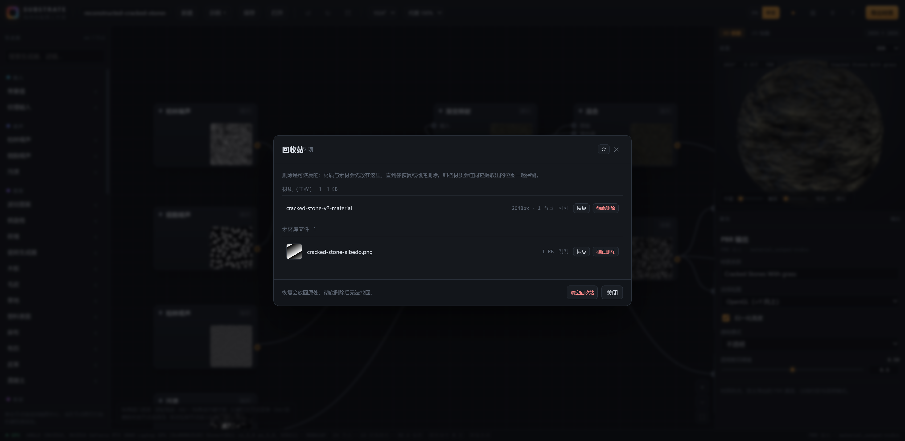
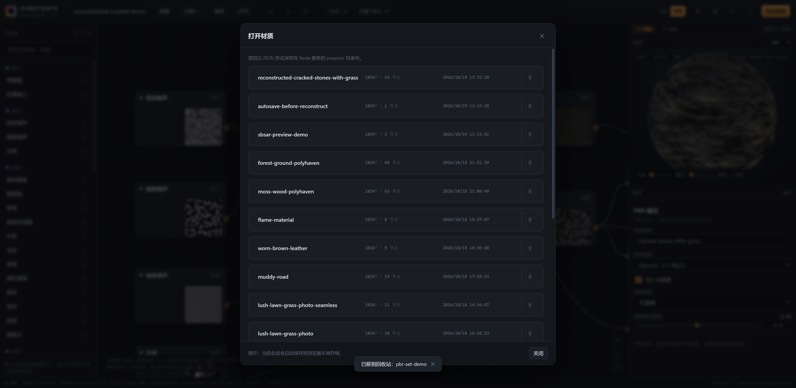
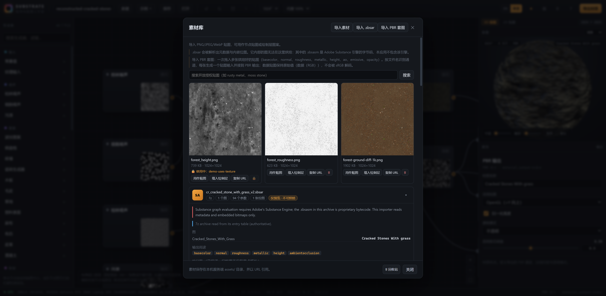
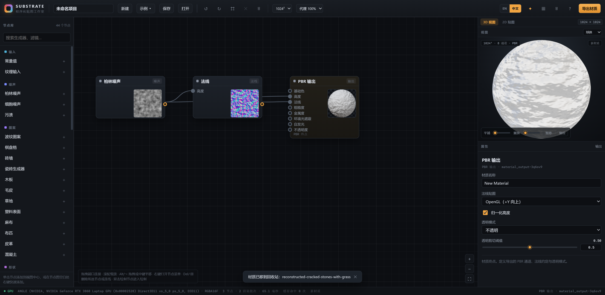
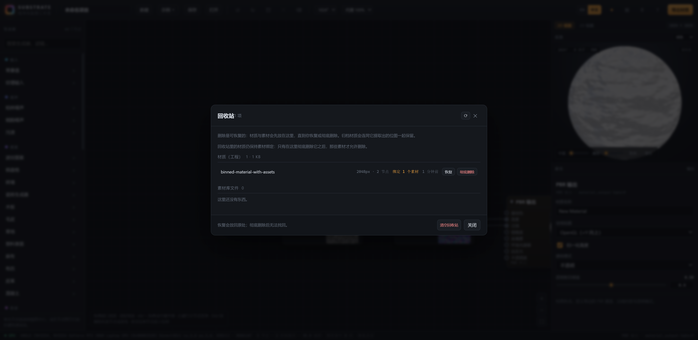
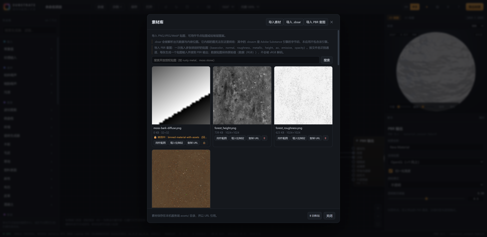

# 回收站（材质可删除 + 可恢复）— 实现记录

> 目标：删除材质不再"一删没"，而是先进回收站；素材库的贴图/归档同理。
> 两处删除入口都改成可逆操作，彻底删除只有回收站里能做。

---

## 1. 数据模型：两类东西，两种存储方式

| 类型 | 删除时发生什么 | 存储位置 | 恢复 |
| --- | --- | --- | --- |
| **材质（工程）** | `projects/<slug>.json` 被 `rename` 到 `trash/project-<id>.json`；元数据（名称/节点数/分辨率/字节数/删除时间）写入 `trash/index.json` | `trash/` + `trash/index.json` | 移回 `projects/`；重名时自动改名为 `<slug>-restored-<id>.json` 并标记 `(restored)` |
| **素材（贴图 / .sbsar）** | **软删除**：`assets/index.json` 里给条目与它提取的子位图打 `deletedAt`，文件仍留在 `assets/` | `assets/index.json` 标记 | 清掉 `deletedAt`；归档会连同它提取的位图一起回来 |

删除 sbsar 时子位图**随父级一起进回收站**（`parentId` 级联），不会出现"父级回来了、子图没了"。

## 2. 后端接口

| 方法 | 路由 | 说明 |
| --- | --- | --- |
| GET | `/api/trash` | `{projects, assets, projectBytes}`（素材仅列"根"条目，归档子图不重复列出，带 `childCount`） |
| POST | `/api/trash/restore` | `{kind:"project"\|"asset", id}` |
| POST | `/api/trash/purge` | 彻底删除单个条目（唯一会 unlink 文件的路径） |
| POST | `/api/trash/empty` | 清空：删除所有回收站工程文件 + 所有软删除素材，返回 `{purged:{projects,assets}}` |
| POST | `/api/projects/delete` | **语义改为**"移到回收站"，返回 `{trashed:{id,name}}`；未知工程返回 404 |
| POST | `/api/assets/delete` | **语义改为**软删除（返回 `deletedAt`），已有 `alreadyTrashed` 幂等保护 |

`GET /api/assets`、`GET /api/projects`、健康检查里的计数都只统计**未删除**条目（`listAssets()` 过滤 `deletedAt`）。
MCP 工具 `substrate_delete_project` 的描述同步改为"移动到回收站（可恢复）"。

## 3. 前端

- 顶栏新增 🗑 按钮 → 「回收站」对话框（`src/components/TrashDialog.js`）
- 对话框分两栏：**材质（工程）** 与 **素材库文件**；每行显示名称、元信息（节点数/分辨率 或 字节数/子位图数）、"多久之前"、`恢复` / `彻底删除`；底部 `清空回收站`
- 「打开」对话框里每个材质行右侧新增 🗑（移到回收站），删除后列表立即刷新并提示 `已移到回收站：<name>`
- 素材库的删除按钮语义改为"移到回收站"（🗑 + tooltip），删除归档时提示"连同 N 张提取的位图"；素材库底部新增「🗑 回收站」入口
- 回收站为空时显示空态；加载失败显示错误而不是静默

## 4. 测试

`npm run test:trash`（25 条断言，跑在真实服务器上，服务未启动则 SKIP）：

| 分组 | 覆盖 |
| --- | --- |
| 材质 | 保存 → 删除（返回 bin id）→ 从材质列表消失 → 出现在回收站且元数据完整 → 恢复回列表 → 再删 → 彻底删除 → 不复活 |
| 素材 | 导入 → 删除（软删，返回 `deletedAt`）→ 从素材库消失 → 进回收站 → 恢复 → 彻底删除 → 不复活 |
| 批量 | 两个素材同时进回收站 → `empty` 返回 `{projects,assets}` → 回收站清空 |
| 错误路径 | 恢复未知条目 404、缺少 id 400、删除未知工程 404 |

> 注意：素材库是**内容寻址**的（同一张图重复导入返回同一 id），所以测试里每张图都用不同像素生成，否则断言会被去重逻辑"吃掉"。

## 6. 删除保护（当前材质锁定 + 素材引用锁定 + 顶栏删除）

### 6.1 正在打开的材质不可删除

- 「打开」对话框里，与当前 `state.projectName` 相同的材质行显示徽章 **正在打开**，删除按钮变成 🔒 且禁用
- 服务端同样把关：`POST /api/projects/active {name}` 记录"正在编辑的材质"（`/api/projects/load` 也会自动设置），
  `POST /api/projects/delete` 对当前材质返回 **409 `PROJECT_ACTIVE`**；`{force:true}` 可强制（MCP/脚本用）
- 打开另一个材质后，原材质即可删除（徽章与按钮随列表刷新）

### 6.2 素材只有"没被任何材质使用"才可删除

- 引用记录：贴图输入节点写 `data.imageAssetId`，绘制层写 `data.patternAssetId`；同时兜底扫描字符串里的 `/assets/<id>` （旧工程也认）
- 服务端 `server/usage.mjs` 扫描 `projects/*.json` 得到 `assetId → [{project,nodeId}]`；归档与它提取的子位图**互相绑定**（任一被引用则整体视为在用）
- `GET /api/assets` 每项带 `usage`；`POST /api/assets/delete` 对在用素材返回 **409 `ASSET_IN_USE`** 并附 `usage`（可用 `force` 覆盖）
- 前端：卡片显示 `🔒 使用中：<材质名>`，删除按钮禁用并给出原因；只有未被引用的素材才显示 🗑
- 当前打开但尚未保存的图也会算作使用（客户端本地集合），因此不会出现"刚应用完贴图就能把源素材删掉"

### 6.3 顶栏删除按钮

编辑器顶栏新增 **✕ 删除所选**（在撤销/重做/自动布局旁边）：

- 有选中节点时启用，tooltip 显示"删除所选 N 个节点（Del）"；无选中时禁用并提示如何选中
- 点击调用 `deleteSelected()`（与 Del 键、右键菜单同一路径），并 toast `已删除 N 个节点`
- 与回收站按钮（🗑）区分：✕ 删的是图里的节点，🗑 打开回收站

### 6.4 测试

`npm run test:trash` 扩充到 **32 条**，新增第 5 组（删除保护）：

| 断言 | 说明 |
| --- | --- |
| 材质列表标记当前打开的材质 | `active: true` |
| 删除当前材质被拒（409 `PROJECT_ACTIVE`） | 服务端强制，不依赖 UI |
| `force` 可强制删除 | 给脚本/MCP 留出口 |
| 素材库报告使用它的材质 | `usage: [{project,nodeId}]` |
| 删除在用素材被拒（409 `ASSET_IN_USE`） | 且素材仍存在 |
| 解除引用后可删除 | 正常进回收站 |

---

## 7. 顶栏「删除当前材质」+ 回收站里的绑定关系

### 7.1 顶栏按钮（仅 graph 模式）

顶栏新增 **⌫ 删除当前材质**，`v-if="state.mode === 'graph'"`——只在节点图模式显示（绘制模式下不出现）。
点击后：

1. `POST /api/projects/delete {name, force:true}` 把**当前打开的材质**移入回收站（`force` 是必要的：
   直接编辑中的材质受 6.1 的锁保护，这是用户显式发起的删除动作）；
2. 编辑器立刻切到空白材质（`newProject()`），避免"正在编辑一个磁盘上已不存在的文件"；
3. toast 提示 `材质已移到回收站：<name>`（未保存过的材质则提示"已新建空白材质"）。

> 图标用 ⌫ 而不是 🗑：🗑 是"打开回收站"，两个按钮不能撞车（初版用 🗑 时点回收站实际触发了删除材质，已修）。

### 7.2 绑定关系：进回收站**不解除**，彻底删除才解除

这是本轮最关键的语义变化：

| 状态 | 素材能否删除 | 依据 |
| --- | --- | --- |
| 材质在 `projects/`（使用中） | ❌ 409 `ASSET_IN_USE` | `scanAssetUsage` 扫 `projects/*.json` |
| 材质**在回收站**（未彻底删） | ❌ 409，usage 里带 `trashed:true` + `trashId` | `scanAssetUsage` 额外扫 `trash/index.json` 指向的工程文件 |
| 材质被**彻底删除**（purge）/ 清空回收站 | ✅ 可删 | 引用随工程文件消失，绑定自然解除 |

实现要点：

- 回收站里的工程 JSON **原样保留**（含 `imageAssetId`/`patternAssetId`），所以绑定天然还在；
  `server/usage.mjs` 的 `scanAssetUsage(projectsDir)` 现在同时读 `trash/`，usage 条目多了 `trashed`/`trashId` 字段；
- 拒绝信息明确写出原因：`… cannot be deleted: <name> (in recycle bin). Bindings are released only when a binned material is permanently deleted.`；
- 前端：素材卡片显示 `🔒 使用中：<材质>（回收站）`，删除按钮仍禁用；
- 回收站列表里每个材质显示 **绑定 N 个素材**（`boundAssets`，由服务端读工程 graph 统计），并有一行说明"只有彻底删除它之后，那些素材才允许删除"。

### 7.3 测试

`npm run test:trash` 扩到 **38 条**，新增第 6 组：

| 断言 | 说明 |
| --- | --- |
| 材质进回收站后素材仍被锁定 | 409，usage 带 `trashed:true` |
| 回收站列表报告绑定数量 | `boundAssets === 1` |
| 彻底删除材质后素材才可删 | purge 前 409 → purge 后 200 |

（第 5 组同时修正：清理引用材质时改为"先 purge 再删素材"，与 7.2 的语义一致。）

---

## 5. 变更文件

- 新增 `server/trash.mjs`（工程回收站 + 合并列表、还原、清空）
- `server/assets.mjs`：`trashAsset` / `restoreAsset` / `listTrashedAssets`；`listAssets`、`assetsCount` 过滤软删除
- `server/index.js`：`/api/trash*` 四个路由；`/api/projects/delete`、`/api/assets/delete` 改为可逆删除
- `src/components/TrashDialog.js`（新）、`src/App.js`（顶栏按钮、项目行删除、对话框）、`src/components/AssetLibrary.js`（删除措辞 + 入口）
- `src/i18n/messages.js`（trash.* 等 22 个键，中英对齐）、`src/styles.css`（回收站与项目行样式）
- `scripts/test-trash.mjs` + `npm run test:trash`
